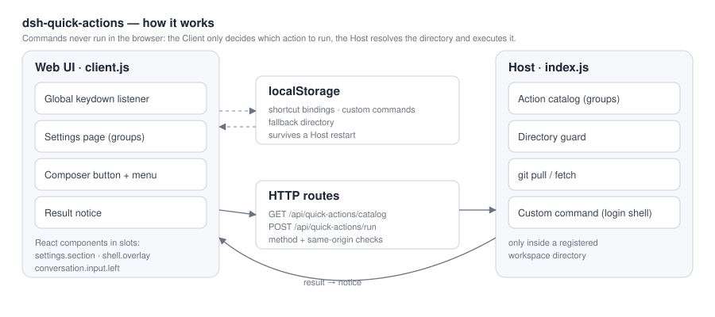

<div align="center">

# dsh-quick-actions

**Keyboard shortcuts for DeepSeek Harness — pull the latest code, run your own shell commands, and open the action menu from the composer, on any screen.**

[](LICENSE)


</div>

> **中文简介**：给 DSH 用的快捷键插件。在任意界面（包括新会话页）按一下就能拉取当前工作区的代码，也可以自己添加任意 shell 命令并绑定快捷键；输入框左边还有一个可点击的入口，点开就是分组动作菜单。快捷键和自定义命令都在设置里维护，存在浏览器本地。



---

## Why

DSH is keyboard-driven, but running something against *the current workspace* — `git pull`, a build, a deploy script — means leaving the conversation. This plugin puts those operations behind a keystroke:

- the listener is installed once and works on the **blank New Session page** and **inside a conversation**;
- "current workspace" is resolved from the session you are looking at, not from a guess;
- the directory is validated on the Host before anything runs;
- everything the UI needs to change (shortcuts, custom commands) lives in the browser, so a tweak never restarts the Host.

## Features

- **Global shortcuts.** A capture-phase `keydown` listener runs while the caret sits in the composer: plain typing stays with the field, while any `Mod` / `Ctrl` / `Alt` combination is treated as a command.
- **Default binding `⌘⇧P`** (`Ctrl+Shift+P` elsewhere) → `git pull --ff-only` in the current workspace, result in a transient notice. It follows the git-GUI "pull" convention and avoids the browser-reserved `⌘T` / `⌘⇧T` / `⌘W`.
- **Clickable entry point.** A keycap button in the composer tool row opens the same grouped actions — one click instead of a keypress — and shows which directory the run will use.
- **Grouped settings page** (`Settings → Quick actions`): Git, Session & layout, and your own **Custom commands** group, each row with a recordable shortcut chip, reset, edit and delete.
- **Custom commands.** Add a name plus a shell line; it is immediately available in the menu and can be bound to any combination. Runs through a **login shell**, so `nvm` / Homebrew / `pyenv` PATH entries are available.
- **Global, not per-session settings.** One preference: a *fallback directory* used only when no current workspace can be identified.
- **Self-diagnosing.** The settings page shows the last key the page actually received (plus `key` / `code` / modifier flags), so a combination swallowed by the OS or browser is obvious instead of looking like a broken plugin.
- **Calm notices.** Success dismisses itself after 6 s (3.2 s without output), failures stay 12 s, hovering pauses the countdown so the output can be selected.
- Bilingual UI (English / 简体中文), following the Harness locale.

## Requirements

- DeepSeek Harness with the Web UI (`dsh web`, the Desktop app, or any profile that mounts `@deepseek-ai/dsh-web-app`).
- Tested against **DSH 0.2.2-rc.1** (the client slot ids and service shapes used here are stable across 0.2.x).

## Install

```bash
git clone https://github.com/Sunshow/dsh-quick-actions.git
```

Then install the directory as a bundle in the current profile — in a DSH session:

```
plugin_manager action=install_bundle target=/absolute/path/to/dsh-quick-actions
```

Or from a shell with the profile's `dsh` on PATH: install through DSH's own bundle manager (the Local bundle page in Settings → Plugins), pointing at the same directory. A directory install is a **link**: `git pull` updates the code without reinstalling.

After installing, refresh the page once (the Client half is loaded at boot) and press `⌘⇧P`.

## Usage

| Where | What |
| --- | --- |
| Any screen | Press a bound shortcut, e.g. `⌘⇧P` |
| Composer tool row | Click the keycap button → grouped action menu |
| Settings → Quick actions | Record, reset, add or edit actions |

Recording a shortcut: click the chip, press the combination (`Esc` cancels, `Backspace` clears). A combination already used by another action is taken over and the previous owner is unbound with a notice.

### Custom commands

Open `Settings → Quick actions → Custom commands → + Add a custom command`:

```
Name      Update dependencies
Command   npm install && npm run build
```

Save, then click its chip to bind a combination. The item appears in the action menu immediately. Commands run in the current workspace directory through `$SHELL -lc` (PowerShell on Windows) with a 120 s timeout; output is shown in the notice.

### Built-in actions

| Action | Default | What it runs |
| --- | --- | --- |
| Pull latest code | `⌘⇧P` / `Ctrl+Shift+P` | `git pull --ff-only` |
| Fetch remote updates | — | `git fetch --all --prune` |
| New session | — | Client-side |
| Toggle sidebar | — | Client-side |

## How it works

| File | Role |
| --- | --- |
| `index.js` | Host half: action catalog, `/api/quick-actions/catalog`, `/api/quick-actions/run`, directory guard, `git` + custom-command execution |
| `client.js` | Browser half: keydown listener, composer button + menu, settings page, key probe, notice |
| `cordis.patch.yml` | Inserts the `quick-actions` Host row |
| `locale/*.json`, `icon.svg` | Plugin Manager metadata |

The two halves talk over `ctx.webServer.register({ kind: 'exact' })` routes rather than a package RPC: the `host.call` builtin is only available to dynamically defined Cordis packages, not to installed bundles.

**Directory resolution** — on-screen session's workspace (`sessions.list` → workspace `sessionIds` → `path`) → that session's `cwd` → the configured fallback directory → the last workspace this browser resolved → the DSH default directory.

## Extending

Groups and built-in actions are data in `index.js`:

```js
const GROUPS = [
  { id: 'git', order: 10, title: { zh: 'Git', en: 'Git' } },
  // …
]

const ACTION_DEFINITIONS = [
  {
    id: 'git.status', group: 'git', order: 30, target: 'host',
    title: { zh: '查看状态', en: 'Status' },
    hint: { zh: '执行 git status --short', en: 'Runs git status --short' },
    commandLabel: 'git status --short',
    defaultShortcut: { mac: '', other: '' },
    command: { bin: 'git', args: ['status', '--short'], timeoutMs: 30000 },
  },
]
```

- `target: 'host'` runs a fixed command on the Host; `target: 'client'` is handled by `runClientAction` in `client.js` (it can use any Client service, e.g. `ctx.get('layout')`).
- Both the settings page and the action menu render from the same catalog, so a new action appears in both.
- User-defined actions need no code at all — they are stored in localStorage and merged into the catalog as `target: 'custom'`.

## Security

- Every action runs **only inside a registered workspace directory**; a request aimed anywhere else is refused.
- Routes check the HTTP method and reject cross-origin requests; request bodies are size-capped.
- Built-in actions are a fixed command table. Custom commands are validated for shape and length before reaching a `login shell` — they run with your user's privileges, so only add commands you trust.
- Bindings and custom commands never leave the browser (localStorage).

## Development

A directory install is a link, so the loop is short:

```bash
# Host change (index.js): reload the row
plugin_manager action=set_plugin target=include:quick-actions enabled=false
plugin_manager action=set_plugin target=include:quick-actions enabled=true

# Client change (client.js): refresh the page
```

`node --check index.js client.js` before shipping.

## License

[MIT](LICENSE) © Sunshow

Not affiliated with DeepSeek. DeepSeek Harness is a DeepSeek product; this is a community plugin.
